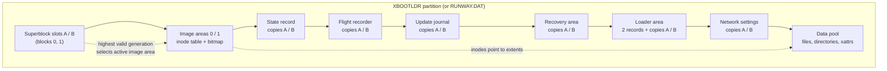
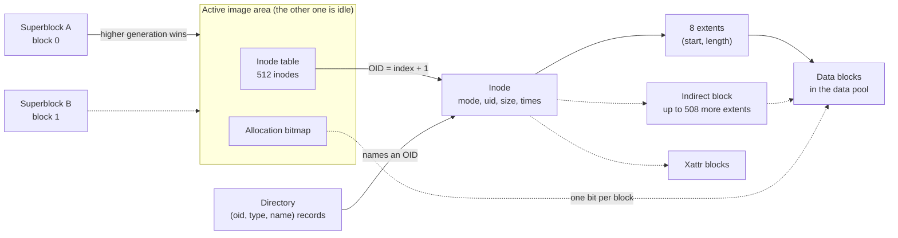
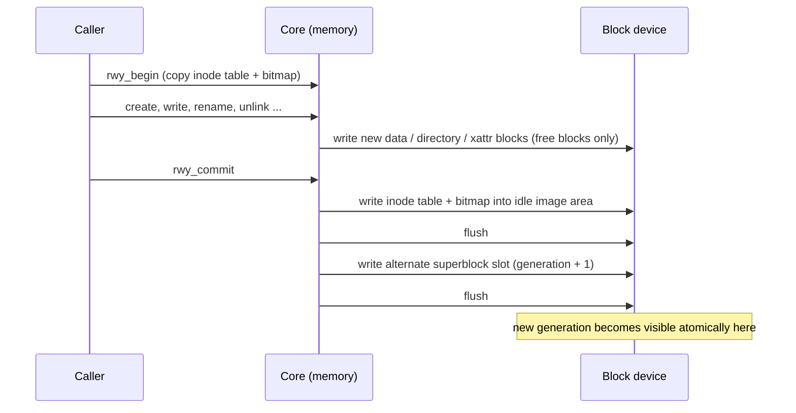
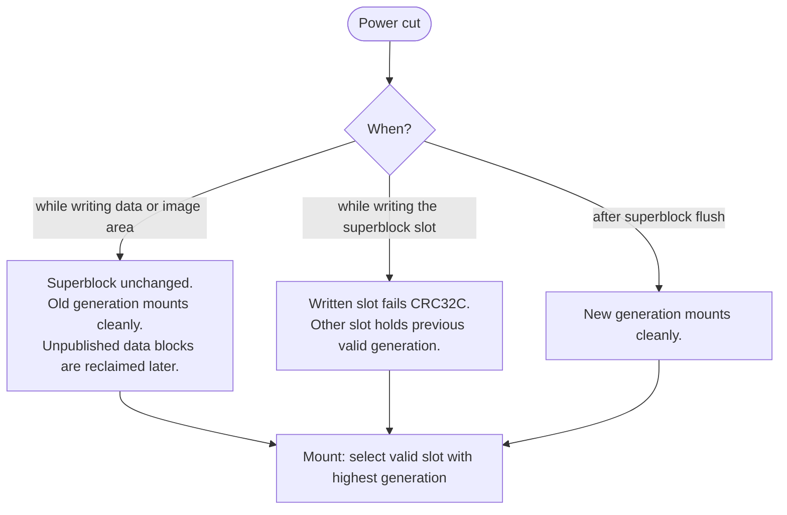
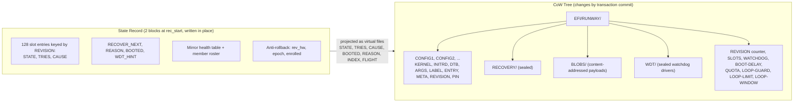
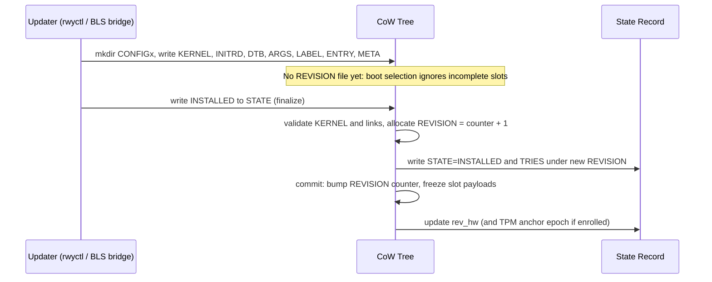
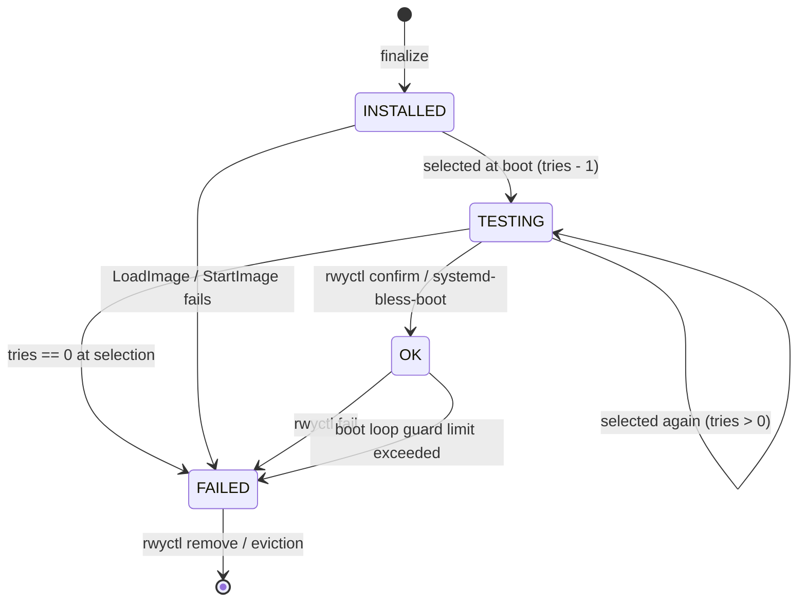
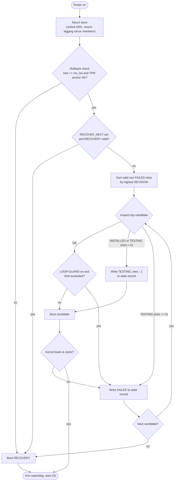

# Runway Architecture and Design

This document describes the architecture, on-disk format, copy-on-write transaction model, boot selection and loader stub design, diagnostic rings, encryption and TPM 2.0 sealing, and source layout of Runway. [`include/rwy_format.h`](../include/rwy_format.h) is the normative reference for all on-disk structures.

---

## 1. Architecture Overview

### 1.1 One core, two environments

Runway is a resilient boot manager and transactional update system for unattended Linux devices. At its center is a single copy-on-write (CoW) filesystem—the **store**—that holds OS boot slots, loader bundles, boot state, and audit logs. One portable C implementation of that filesystem runs in two places:

- **UEFI firmware (`RUNWAY.EFI` / `rwy-loader.efi`):** Opens the store before any OS starts, verifies anti-rollback state, selects the OS slot (or recovery image), arms hardware watchdogs, and transfers execution to the kernel or UKI.
- **Linux userspace (`rwy-fuse` and `rwyctl`):** Exposes the same store to the running OS, including a synthetic Boot Loader Specification (BLS Type 1 and Type 2 UKI) directory tree at `/boot` that standard tools (`bootctl`, `kernel-install`, `systemd-bless-boot`) use without modification.

The filesystem core has no UEFI or POSIX dependency. Both environments provide a block device interface (`rwy_block_dev_t`) and, when the store is encrypted, a key provider. Because firmware and userspace execute the exact same filesystem and state-machine code, they cannot disagree on the store's contents or state.

### 1.2 Why a dedicated filesystem for a UKI and boot store?

Unattended edge and industrial devices impose two requirements on the boot store that conflict in traditional boot architectures:

1. **Linux userspace** must stage multi-megabyte Unified Kernel Images (UKIs) or kernel/initrd/DTB sets, update boot entries, and evict old slots atomically across power cuts.
2. **UEFI firmware** must read those payloads and *write* back boot-assessment state (decrementing trial counters, condemning failed slots, recording flight-recorder diagnostics, and catching up lagging mirrors) before the OS starts, even when the store is 100% full or a power loss interrupts the boot.

Neither FAT nor general-purpose OS filesystems fit both sides of this problem:

- **Why not FAT on the ESP?**
  - **No atomic updates or crash safety:** FAT has no copy-on-write, no journal, and no metadata checksums. A power cut while writing a UKI, deleting an old image, or renaming a BLS boot-counting filename (`+<tries>-<done>.efi`) can leave a half-written payload, orphaned clusters, or a corrupted directory entry that prevents the device from booting.
  - **Unreliable firmware FAT and NVRAM write paths:** While UEFI mandates FAT for the ESP, many firmware `EFI_SIMPLE_FILE_SYSTEM_PROTOCOL` implementations are only tested for reads and misbehave on in-place writes or renames (some truncate files on partial writes or fail to flush). Storing trial counters in UEFI NVRAM via `SetVariable` is similarly brittle across embedded boards due to flash wear, small variable stores, and non-atomic updates.
  - **No native encryption, anti-rollback, or mirroring:** FAT provides no authenticated block encryption sealed to TPM 2.0, no rollback protection against offline disk replacement, and no multi-disk replication.
- **Why not a general-purpose Linux filesystem (ext4, XFS, Btrfs, ZFS)?**
  - **Too complex for pre-boot read-write execution:** General-purpose filesystems are built for millions of files, deep B-trees or extent trees, POSIX concurrency, and multi-terabyte volumes. Carrying a read-write journaled or B-tree filesystem driver inside a UEFI boot loader brings tens of thousands of lines of complex recovery and allocation logic into pre-boot firmware. Read-only UEFI filesystem drivers avoid that risk, but cannot update trial counters or condemn a broken slot at boot time.
  - **Free-space deadlocks on full volumes:** In general-purpose copy-on-write filesystems, even unlinking a file or updating a small state file requires allocating new metadata tree blocks and can fail with `ENOSPC` when the volume is full.
- **How optimizing and simplifying for a UKI store solves both:**
  - **Bounded scale replaces dynamic metadata trees:** A boot store never holds millions of small files; it holds a few large immutable UKI/kernel payloads and small configuration files (64 MiB to 4095 MiB, at most 512 inodes). At that scale, the entire 512-inode table (35 blocks) and allocation bitmap fit in memory and are written as a flat array into two fixed alternating image areas. Commits flip a single superblock slot with no journal replay and no B-tree balancing.
  - **Zero-allocation boot state updates:** Static slot payloads live in the CoW tree, while mutable boot-assessment state (`STATE`, `TRIES`, `CAUSE`, `BOOTED`) lives in a fixed two-block ping-pong state record updated in place by sequence number. Firmware can always decrement tries or mark a slot `FAILED` with two 4 KiB block writes, needing zero free blocks and zero filesystem transactions.
  - **Guaranteed space recovery:** A fixed 64-block deletion reserve (`RWY_RESERVE_BLOCKS`) ensures `unlink` and slot removal always succeed on a 100% full store.
  - **Contiguous extent streaming:** Large UKIs and initrds are allocated as single contiguous runs of 4 KiB blocks (8 direct extents per inode plus 1 indirect block), streaming straight through `EFI_BLOCK_IO_PROTOCOL` (and optional AES-256-XTS + SHA-256 verification) without filesystem fragmentation overhead.

### 1.3 Where the store lives

The preferred home for the store is a dedicated GPT partition of type `XBOOTLDR` (`BC13C2FF-59E6-4262-A352-B275FD6F7172`), starting at byte 0 of the partition with no outer filesystem:

```text
Runway 4 KiB block -> XBOOTLDR partition -> disk
```

The EFI System Partition (ESP) stays small and holds only `RUNWAY.EFI`. Firmware reads and writes the store partition directly through `EFI_BLOCK_IO_PROTOCOL`, keeping the firmware FAT driver out of the boot write path (some firmware FAT drivers truncate files on in-place writes).

Where a separate partition is not possible, the fallback layout stores the exact same image as a single file (`\RUNWAY.DAT`) on the FAT ESP:

```text
Runway 4 KiB block -> RUNWAY.DAT -> FAT file / Linux file -> disk
```

The core assumes nothing about the storage layer below it: writes may be torn or stale, and there are no transactional guarantees other than `flush`. Crash safety comes entirely from Runway's own copy-on-write commit protocol and ping-pong metadata areas.

### 1.4 On-disk layout

Every store is divided into 4096-byte (`RWY_BLOCK_SIZE`) blocks with the same contiguous layout:



| Part | Description | Encryption |
|---|---|---|
| Superblock slots (A / B) | Blocks 0 and 1. Point to the active inode table and bitmap, carry generation number, store/member UUIDs, area geometry, keyslot header (at offset 512), and CRC32C. | Plaintext |
| Image areas (0 / 1) | Two fixed-size alternating areas. Each holds a complete 512-inode table (35 blocks) and allocation bitmap (3 blocks on a 256 MiB store). | Encrypted |
| State record (A / B) | Two blocks (`rec_start`, `rec_start + 1`) written in place by sequence number. Hold runtime slot state (`STATE`, `TRIES`, `CAUSE`), `BOOTED`, `RECOVER_NEXT`, mirror health counters, and anti-rollback epoch. | Encrypted |
| Flight recorder (A / B) | Optional A/B ping-pong ring buffer (`flight_start`, `2 * flight_blocks`) recording boot attempts, try decrements, and condemnations. | Plaintext |
| Update journal (A / B) | Optional A/B ping-pong ring buffer (`journal_start`, `2 * journal_blocks`) recording administrative slot changes with a SHA-256 hash chain. | Encrypted |
| Recovery area (A / B) | Optional A/B flat bundle area (`recovery_start`, `2 * recovery_blocks`) holding a fallback kernel/initrd/DTB/cmdline readable without the store key. | Plaintext |
| Loader area (A / B) | Optional area (`loader_start`, `2 + 2 * loader_blocks`) holding two loader state record blocks and A/B bundles of `rwy-loader.efi` plus watchdog drivers. | Plaintext |
| Network settings (A / B) | Optional A/B block pair (`net_start`, `2 * net_blocks`) holding static IPv4 and UDP syslog target settings for abnormal-boot flight reports. | Plaintext |
| Data pool | Starts at `pool_start`. Holds file data, directory blocks, indirect extent blocks, and extended attribute blocks. | Encrypted |

### 1.5 Comparison with other filesystems and boot loaders

Runway reuses proven techniques from established filesystems and boot loaders, simplified for the bounded scale of a boot store (64 MiB to 4095 MiB, at most 512 inodes, a few large UKI/kernel payloads):

| Mechanism | Runway | Proven counterpart | Why Runway fits the boot domain |
|---|---|---|---|
| Crash safety | Copy-on-write data + atomic superblock slot switch (no journal) | Btrfs, ZFS | Whole inode table (35 blocks) and bitmap rewrite into a fixed inactive image area; commits need zero free data pool blocks |
| Root selection | Two superblock slots, highest valid generation with valid CRC32C wins | ZFS uberblocks (`txg`), Btrfs superblocks | No log replay required at mount time in UEFI firmware |
| Metadata integrity | CRC32C in every metadata block (`rwy_blk_header_t`) | ext4 `metadata_csum`, XFS v5, Btrfs | Detects torn writes on both raw partitions and FAT files |
| File extents | 8 direct `(start, len)` extents in inode + 1 indirect block (up to 508 more) | ext4, XFS, Btrfs | Large kernels and UKIs occupy single contiguous runs |
| Deletion reserve | Last 64 data blocks (`RWY_RESERVE_BLOCKS`) reserved for `unlink`/`rmdir`/shrink | Btrfs global reserve, XFS reserved blocks | A 100% full store can always delete a slot or file |
| Boot state record | Two blocks written in place, higher sequence number wins | U-Boot redundant env, EFI Boot Guard `BGENV.DAT` | Decrementing `TRIES` or marking a slot `FAILED` requires no free data blocks, no inode, and no CoW tree commit |
| Mirroring | Multi-device mirror layer below the core with per-member UUIDs | ZFS vdev GUIDs, Btrfs RAID1 | Firmware catches lagging members up automatically and boots degraded when a disk fails |

---

## 2. On-Disk Format and Copy-on-Write Engine

### 2.1 Format v11 structures (`include/rwy_format.h`)

- **Superblock (`rwy_superblock_t`):** Magic `"RUNWAYSB"`, `version = 11`, `block_size = 4096`, `total_blocks` (up to `1048320` for 4095 MiB), `max_inodes = 512`, monotonic `generation >= 1`, `root_oid = 1`, active image area pointers (`inode_tbl_start`, `bitmap_start`), geometry of all fixed areas, feature flags (`feat_compat`, `feat_incompat`), store `uuid[16]`, per-replica `member_uuid[16]`, and Castagnoli `crc32c`. Unknown `feat_incompat` bits refuse to mount.
- **Metadata block header (`rwy_blk_header_t`, 32 bytes):** Placed at the start of every inode-table block (kind 1), bitmap block (kind 2), indirect extent block (kind 3), xattr block (kind 4), state record block (kind 5), flight header block (kind 6), update journal header block (kind 7), and network settings block (kind 8). Carries magic `"RUNWAYB1"`, `generation`, `index`, `kind`, and full-block `crc32c`.
- **Inodes (`rwy_inode_t`, 256 bytes, 15 per block across 35 blocks):** Object ID (`OID = index + 1`, stable across CoW relocation and defragmentation), type (`FREE`, `FILE`, `DIR`, `SYMLINK`), POSIX `mode`, `uid`, `gid`, 64-bit `size`, `(sec, nsec)` timestamps (`atime`, `mtime`, `ctime`, `btime`), `nlink`, `xattr_root`, 8 direct extents `(start, len)`, and `indirect_block` (holding up to 508 additional extents, for 516 extents total).
- **Directories:** Regular CoW data blocks containing aligned `(oid, reclen, type, namelen, name)` records. Directory entries reference logical OIDs, never physical block numbers.
- **Extended attributes (`rwy_xattr_header_t`):** Chained blocks of packed `(namelen, valuelen, flags, name, value)` records supporting `user.*`, `security.*`, `trusted.*`, and `system.*`.



### 2.2 Transactional CoW and commit protocol

Every filesystem mutation runs inside a transaction (`rwy_begin`, `rwy_commit`, `rwy_abort`):

1. `rwy_begin` copies the committed inode table and allocation bitmap into working memory.
2. File writes, directory updates, and xattr changes allocate fresh blocks from the data pool and never overwrite blocks belonging to the committed generation. Blocks freed during the transaction remain reserved in the allocator until the transaction commits, so an `abort` or crash always leaves the committed generation intact. Because both copies exist until commit, replacing a file in a single transaction requires free space for the new copy alongside the old one.
3. `rwy_commit` writes the working inode table and bitmap into the **inactive** image area (area `(generation) % 2`), flushes the device, writes the alternate superblock slot with `generation + 1`, and flushes again.



What a reader sees after a power cut at any point:



#### Durability boundaries

- **UEFI (`rwy_fs.c`):** Keeps one transaction open per session; mutating calls stage into it and `EFI_FILE_PROTOCOL.Flush` commits and flushes the backing device.
- **Linux FUSE (`fuse/rwy_fuse.c`):** Every mutating system call executes in its own transaction and commits before returning. Renaming over an existing file (such as a UKI update) is a single atomic transaction.

#### Deletion reserve

The last 64 free blocks (`RWY_RESERVE_BLOCKS`, 256 KiB) of the data pool are withheld from normal allocations (`create`, `write`, `mkdir`, slot installation) and reported as unavailable in `statfs` and EFI volume info. Only `unlink`, `rmdir`, and shrinking `truncate` may allocate from the reserve to rewrite the parent directory block(s), guaranteeing that a full store can always delete files or slots to recover space.

### 2.3 Space reclamation (`rwy_gc`) and offline compaction (`rwy_defrag`)

Because inode tables and bitmaps are written to fixed alternating image areas, normal commits leave no unreachable metadata blocks behind.

- **Garbage collection (`rwy_gc` in `src/rwy_gc.c`):** Recomputes block reachability (`rwy_mark_data_reachable`) from all live inodes in the committed generation, rebuilds the allocation bitmap, writes the table and bitmap to the inactive image area, and publishes one new generation. `fsck.runway` uses the exact same reachability function, so the collector and checker never disagree. In-memory allocation also compacts unreclaimed bits once automatically before returning `RWY_ERR_NOSPC`.
- **Offline defragmentation (`rwy_defrag` in `src/rwy_defrag.c`, `fsck.runway --defrag`):** Rewrites all fragmented live objects (`extent_count > 1` or using an indirect block) into single contiguous block runs while leaving already-contiguous objects untouched in place, then publishes the result as a single new generation.

### 2.4 POSIX semantics

- **Persistent attributes:** Full POSIX `mode` (including `suid`/`sgid`/`sticky`), 32-bit `uid`/`gid`, 64-bit nanosecond timestamps, hardlinks (`nlink`), relative/absolute symlinks (with loop limit `RWY_SYMLOOP_MAX = 32`), and extended attributes persist across remounts and reboots.
- **UEFI defaults:** Objects created from UEFI receive `0644` (files) or `0755` (directories) with `uid = gid = 0`. UEFI writes to existing files preserve their existing POSIX mode and ownership.

---

## 3. Boot Selection, Slots, and Loader Architecture

### 3.1 Frozen stub (`RUNWAY.EFI`) and loader area (`rwy-loader.efi`)

When a store reserves a plaintext loader area (`loader_start`, `2 + 2 * loader_blocks`), Runway separates the ESP binary from the feature-rich boot loader:

- **Frozen stub (`src/rwy_stub_main.c`, built as `RUNWAY.EFI`):** Installed on the ESP at `\EFI\BOOT\BOOT<ARCH>.EFI` and `\EFI\RUNWAY\RUNWAY.EFI`. Contains no filesystem or cryptographic code; it locates the boot store partition (or `RUNWAY.DAT`), reads the two loader state record blocks (`rwy_loader_record_t`, `src/rwy_loader_fsm.c`), arbitrates A/B trial state, arms hardware and UEFI watchdogs, sets the volatile `RunwayLoaderHandshake` variable, and launches `rwy-loader.efi` from the chosen bundle copy (A or B) via `LoadImage` / `StartImage`.
- **Loader bundles (`src/rwy_bundle.c`):** Each copy (A and B) in the loader area is a flat bundle with a CRC32C-protected header (`rwy_bundle_header_t`), the `rwy-loader.efi` image (`RWY_ENTRY_LOADER`), and optional watchdog driver binaries (`RWY_ENTRY_WDT`), each verified by SHA-256 before execution.
- **A/B loader trial lifecycle:**
  1. `rwyctl loader set` writes the new bundle into the inactive copy (A or B) and updates the loader state record with `trial`, `tries`, and `timeout`.
  2. On reboot, the stub decrements `tries`, commits the loader state record, arms the watchdog, and starts the trial loader.
  3. Once the trial `rwy-loader.efi` mounts the store and selects an OS boot target, it calls `rwy_loader_confirm` (or the operator runs `rwyctl loader commit`), promoting the trial copy to `good` across all mirror members.
  4. If the trial loader fails to start, crashes, or hangs until the watchdog resets the system, the stub decrements `tries` (or immediately marks the copy bad on `StartImage` error) and falls back to the confirmed `good` copy.

When a store has no loader area (`loader_blocks == 0`), the full loader (`rwy-loader.efi`) can be installed directly as `RUNWAY.EFI` on the ESP.

### 3.2 Native slot tree (`EFI/RUNWAY/`) and in-place state record

Native OS slot management lives under `EFI/RUNWAY/`. To ensure boot state updates (decrementing `TRIES`, marking a slot `FAILED`, recording `BOOTED`) require zero free data blocks and zero CoW commits, static slot payloads live in the CoW directory tree while mutable runtime state lives in the two-block **state record**:



#### Slot installation and content-addressed `BLOBS/`



- **Content-addressed blobs (`src/rwy_blob.c`, `src/rwy_bootblob.c`):** A 64-character lowercase hex name under `EFI/RUNWAY/BLOBS/<sha256>` is an immutable content blob managed only by the `SYSTEM` actor (`rwyctl --dedup` and the FUSE BLS bridge). Multiple slots can hardlink the same blob. At the end of any transaction that removes a slot or unlinks a payload, `rwy_bootcfg` sweeps any content blob whose link count dropped to 1 (only the `BLOBS/` entry left) in the same commit.
- **Storage quota (`QUOTA`) and slot cap (`SLOTS`):** Before installing a new slot, `rwyctl` plans the eviction of removable slots (`incomplete`, then `FAILED`, then oldest `OK`, then oldest `INSTALLED`) while protecting the booted slot, the newest `OK` slot (and second-newest `OK` slot when `RECOVERY/` is absent), slots under trial, the next slot to boot, and pinned slots (`PIN = 1`). Planned evictions commit first (recording `EVICT` entries in the update journal), followed by optional defragmentation if free space is scattered, and finally the new slot installation.

### 3.3 Boot selection state machine and boot loop guard



At boot (`src/rwy_bootsel.c`, `src/rwy_slotboot.c`):



- **Failure resilience:** State record changes are flushed before starting the kernel, and `RECOVER_NEXT` is cleared in the same write so a broken recovery image cannot trap the device. If the state record cannot be written due to media failure, the loader retries three times and then boots the newest confirmed `OK` slot without recording (`RunwayBoot=unrecorded`), never an unconfirmed slot.
- **Boot loop guard (`src/rwy_loopguard.c`, `src/rwy_guardvar.c`):** When `LOOP-GUARD` is `on`, the loader tracks consecutive boots of the same `OK` slot inside `LOOP-WINDOW` seconds using the non-volatile `RunwayBootGuard` EFI variable (`revision`, `count`, `first_time`). On entry `LOOP-LIMIT + 1`, the loader marks the slot `FAILED` (`CAUSE=boot_loop`) and selects the next older `OK` slot or `RECOVERY` in the same boot pass—unless no fallback exists, in which case it logs a `LOOP_LIMIT` flight event and keeps booting the sole remaining slot. Confirming the slot in userspace deletes `RunwayBootGuard`.

### 3.4 Synthetic BLS projection and FUSE RPC

When `rwy-fuse` mounts a store at `/boot`, it synthesizes a Boot Loader Specification view (`src/rwy_bls_name.c`, `rwy_bls_parse.c`, `rwy_bls_render.c`, `rwy_bls_commit.c`, `rwy_bls_view.c`):
- Finalized slots appear as Type 1 `.conf` files under `/boot/loader/entries/` (with `+N` boot-counting suffixes when `INSTALLED` or `TESTING`) or Type 2 UKIs under `/boot/EFI/Linux/`, along with payload directories and `/boot/loader/loader.conf`.
- **`rwy_bls_view.c` snapshot:** `rwy-fuse` caches a read-only in-memory snapshot of the projected BLS tree keyed by `(store_uuid, generation, record_sequence, mount_id)`, serving `getattr`/`readdir`/`lookup` without rescanning slots on every request. Any store commit or state record update invalidates and rebuilds the snapshot on the next request.
- **In-process RPC (`tools/rwyctl_rpc.c`, `fuse/rwy_fuse_store.c`):** While mounted, `rwy-fuse` listens on `/run/rwy-fuse/<uuid>.sock`. When `rwyctl` targets the mounted store, it passes its argv and open file descriptors (`SCM_RIGHTS`) over the socket; `rwy-fuse` runs the command in-process on its single-threaded event loop, invalidates its directory and BLS caches if the store changed, and returns the exit status.

---

## 4. Resilience, Diagnostics, and Recovery

### 4.1 State record, mirror resync, and health counters

The state record (`src/rwy_record.c`, `src/rwy_slotstate.c`) occupies two blocks (`rec_start`, `rec_start + 1`). Each write updates the non-current copy with `sequence + 1` and a CRC32C checksum, then flushes. Mount selects the valid copy with the higher sequence; if both copies are damaged, mount starts from an empty in-memory record (`rwy_record_damaged`) and increments `record_reset` on the next heal write so damaged state records never prevent booting an `OK` kernel.

 across a mirror (`src/rwy_mirror.c`, `src/rwy_resync.c`):
- Each replica carries the shared store `uuid` and its own unique `member_uuid` in the superblock.
- Because state record writes do not bump the superblock `generation`, mirror members at the same generation can hold different record sequences, or a member behind in `generation` can hold a newer state record. Before catching up a lagging member's blocks, `rwy_record_sync` merges the highest-sequence state record and takes the per-member maximum of the health counters (`rwy_record_merge_health`: `LAGGING`, `SYNC_FAILED`, `WRITE_FAILED`, `MISSING`) and the union of the 8-entry member UUID roster.

### 4.2 Plaintext recovery area

An encrypted store can reserve a plaintext recovery area (`recovery_start`, `2 * recovery_blocks`, `src/rwy_recarea.c`, `src/rwy_recboot.c`) outside the encrypted block range:
- Holds two A/B flat bundles (`rwy_ra_header_t` with magic, version, sequence, CRC32C, and SHA-256 digests for `KERNEL`, `INITRD`, `DTB`, and `ARGS`).
- `rwy_ra_write` writes the inactive copy, flushes, verifies the read-back hashes, and writes the header with `sequence + 1`.
- When the boot store cannot be unlocked or mounted, or when all slots in the store have failed and no in-store `RECOVERY/` slot exists, the loader reads the raw member devices directly without encryption keys, selects the highest-sequence valid bundle copy, and boots it.

### 4.3 Flight recorder, update journal, and network flight report

Both diagnostic rings use A/B ping-pong copy staging with circular wrap-around so logging never blocks or fails with `NOSPC`:

1. **Flight recorder (`src/rwy_flight.c`, plaintext):** Located at `flight_start` (`2 * flight_blocks`). Records 64-byte entries for `BOOT`, `CONDEMN`, `TRIES`, `RECOVER_NEXT`, and `LOOP_LIMIT`. Readable directly from raw storage without encryption keys and exposed in reverse-chronological order via `EFI/RUNWAY/FLIGHT` and `rwyctl flight show`.
2. **Update journal (`src/rwy_transplog.c`, encrypted):** Located at `journal_start` (`2 * journal_blocks`). Records 384-byte entries for `INSTALL`, `UPDATE`, `CONFIRM`, `FAIL`, `REMOVE`, and `EVICT`. Each entry carries a monotonic sequence `seq`, dual-binding sequences (`generation`, `rec_seq`), rolling SHA-256 chain link (`prev_hash = SHA256(entry_{i-1})`), slot `payload_hash`, slot `label`, anti-rollback `epoch`, and `entry_hash`.

#### Dual-binding atomicity model

- **CoW transactions (`install`, `update`, `remove`, `evict`):** Stage the journal entry to the inactive ring copy with `entry.generation = G + 1` and flush before `rwy_commit()` publishes superblock generation `G + 1`. Readers discard entries with `entry.generation > sb.generation`.
- **State record updates (boot selection, try decrements, condemnations, `confirm`, `fail`):** Stage the flight/journal entry to the inactive ring copy with `entry.rec_seq = S + 1` and flush before `rwy_record_write()` publishes state record sequence `S + 1`. Readers discard entries with `entry.rec_seq > record.sequence`.

#### Network flight report (`src/rwy_netreport.c`, `src/rwy_netset.c`)

When an abnormal boot decision occurs and plaintext network settings (`net_start`, `2 * net_blocks`) are configured, the loader brings up only the configured administration NIC (matched by permanent MAC address), configures its static IPv4 address without DHCP, and transmits the current boot's flight events plus up to `LOG-BACKLOG` prior ring events as RFC 5424 UDP syslog messages within `LOG-TIMEOUT` seconds before starting the OS. Normal boots execute no network code.

---

## 5. Block-Layer Encryption, TPM 2.0 Sealing, and Anti-Rollback

### 5.1 Architectural separation and crypto primitives

The filesystem core and consistency checker are key-agnostic. Block encryption operates below the core in a `rwy_block_dev_t` wrapper (`src/rwy_cryptodev.c`), encrypting every 4096-byte block outside the plaintext ranges (superblocks, flight recorder, recovery area, loader area, network settings) with **AES-256-XTS** using the logical block index as the tweak.

Cryptographic primitives (`SHA-256`, `HMAC-SHA256`, `PBKDF2-HMAC-SHA256`, `AES-256-XTS`, RNG) are dispatched through `rwy_crypto_ops_t` (`src/rwy_crypto.c`):
- **UEFI binaries:** Use the built-in freestanding implementation (`src/rwy_sha256.c`, `src/rwy_aes.c`, `src/rwy_xts.c`) accelerated by CPU instructions (`src/rwy_aesni.h` on x86_64 and `src/rwy_aesarm.h` on arm64, with portable C fallback). Random bytes combine `EFI_RNG_PROTOCOL` and `TPM2_GetRandom` (`efi_random()`).
- **Host and Linux tools:** Default to OpenSSL (`tools/crypto_openssl.c`) for hardware-accelerated SHA-256 and AES-XTS, with `RWY_CRYPTO=builtin` available to test the freestanding implementation and `src/rwy_drbg.c` (NIST SP 800-90A HMAC-DRBG) for deterministic test image generation (`mkstore --random-seed`).

### 5.2 Keyslots and first-boot TPM re-encryption

Each superblock slot carries a `rwy_keyslot_header_t` at offset 512 (`src/rwy_keyslot.c`), validated by its own CRC32C alongside the superblock CRC32C:
- **Slot 0 (Factory / Transport):** Wraps the factory Data Encryption Key (`DEK_factory`) under a PBKDF2-HMAC-SHA256 passphrase.
- **Slot 1 (UEFI TPM 2.0):** Holds the runtime DEK sealed to the target's TPM 2.0 Storage Root Key bound to **PCR 7** (UEFI Secure Boot policy state).
- **Slot 2 (Recovery / OS):** Optional passphrase or auxiliary keyslot.

#### Provisioning to first-boot enrollment lifecycle

1. **Factory image build:** `mkstore --encrypt` generates `DEK_factory`, encrypts the store, and populates Slot 0.
2. **First boot on target (`src/rwy_unlock.c`, `src/rwy_reencrypt.c`, `src/rwy_relocate.c`):**
   - Requires UEFI Secure Boot active (`SecureBoot=1`, `SetupMode=0`).
   - Unwraps `DEK_factory` from Slot 0, generates a fresh random `DEK_runtime`, seals `DEK_runtime` into Slot 1 under PCR 7 (`EFI_TCG2_PROTOCOL`), and verifies an unseal round-trip before touching the disk.
   - Verifies that free space covers all live blocks (`rwy_reencrypt` pre-flight check).
   - Writes the inactive state record and active update journal under `DEK_runtime`, relocates all live file/directory/xattr blocks to free blocks encrypted under `DEK_runtime` (`rwy_relocate`), and publishes generation `N + 1` in the alternate superblock slot with Slot 1 active and Slot 0 cleared.
   - Re-keys the crypto block device in place, zeroes all blocks that belonged to `DEK_factory`, and publishes generation `N + 2` in the other superblock slot so no factory keyslot or factory ciphertext remains on disk.
   - If interrupted by a power cut at any step, the next boot mounts under the valid superblock slot's key and resumes or completes finalization automatically. If pre-flight checks fail (e.g., degraded mirror or insufficient space), the loader boots under `DEK_factory` and retries re-encryption on the next boot.
3. **Subsequent boots:** The loader unseals `DEK_runtime` from Slot 1 via `TPM2_Unseal`. If Secure Boot is altered, PCR 7 changes, the TPM refuses to unseal, and the loader falls back to the plaintext recovery area (or returns `EFI_NOT_FOUND`).

### 5.3 Anti-rollback protection

Runway defends against offline replay of old store images at two levels (`src/rwy_anchor.c`, `src/rwy_efianchor.c`):
1. **Tree-to-record binding (`rev_hw`):** The state record stores `rev_hw`, the highest `EFI/RUNWAY/REVISION` ever committed. If an older CoW tree is spliced under a newer state record (`REVISION < rev_hw`), boot selection refuses the store with `RWY_ERR_ROLLBACK`.
2. **TPM NV monotonic counter (`epoch`):** On an enrolled store, a TPM 2.0 NV counter (index derived from the store UUID, read and incremented under PCR 7 policy) tracks the state record `epoch`. Every slot installation, removal, eviction, or transition to `FAILED` writes `epoch + 1` to the state record first and then increments the TPM counter. On boot, `rwy_anchor_check` compares `epoch` against the TPM counter:
   - `epoch == counter`: Valid.
   - `epoch == counter + 1`: Completes the interrupted TPM increment from a power cut between the record write and counter increment.
   - `epoch < counter`, `epoch > counter + 1`, missing counter on an enrolled store, or existing counter on a store claiming to be unenrolled (`RWY_ANCHOR_STRAY`): Rollback detected (`RWY_ERR_ROLLBACK`). The loader refuses to boot normal slots and boots only `RECOVERY`.

---

## 6. Source Layout

### 6.1 Portable core and crypto (`src/`, `include/`)

Public headers live in `include/` (`rwy_format.h`, `rwy_core.h`, `rwy_block.h`, `rwy_crypto.h`, `rwy_recarea.h`); shared internal declarations live in `src/rwy_internal.h`.

| File | Responsibility |
|---|---|
| `rwy_util.c` | CRC32C, error strings, string and UUID helpers |
| `rwy_io.c`, `rwy_iostat.c` | Block I/O helpers, metadata block headers/CRC, 64-block directory read cache, I/O counters |
| `rwy_mirror.c` | Multi-device mirror block layer and per-member failure tracking |
| `rwy_mount.c` | Superblock validation, mount/remount, and time source |
| `rwy_alloc.c` | Allocation bitmap, deletion reserve, and contiguous run allocator |
| `rwy_txn.c` | `rwy_begin`, `rwy_abort`, `rwy_commit`, and atomic superblock publication |
| `rwy_inode.c`, `rwy_file.c` | Inode access, direct/indirect extent maps, CoW file read/write/truncate |
| `rwy_dir.c`, `rwy_ns.c` | Directory records, path resolution (including symlinks), create/mkdir/link/unlink/rename |
| `rwy_xattr.c` | Chained extended attribute blocks |
| `rwy_oneshot.c` | Single-transaction convenience wrappers |
| `rwy_gc.c`, `rwy_defrag.c`, `rwy_relocate.c` | Block reachability, garbage collection, offline compaction, and live-block relocation |
| `rwy_record.c`, `rwy_slotstate.c`, `rwy_virt.c` | In-place state record, mirror health/roster merge, slot runtime state, and virtual files (`STATE`, `TRIES`, `BOOTED`, `INDEX`, `FLIGHT`) |
| `rwy_bootcfg.c`, `rwy_bootsel.c`, `rwy_bootaudit.c` | `EFI/RUNWAY/` schema rules, slot finalization, quota eviction planning, boot selection, and `check` audit |
| `rwy_blob.c`, `rwy_bootblob.c` | Streaming SHA-256 content-blob naming, orphan sweep, and `BLOBS/` integrity verification |
| `rwy_entry.c`, `rwy_meta.c`, `rwy_bls_*.c` | BLS entry naming, parsing, rendering, committing, and cached `rwy_bls_view.c` projection snapshot |
| `rwy_bundle.c`, `rwy_recarea.c`, `rwy_loader_fsm.c` | Flat bundle verifier/writer, plaintext recovery area, and A/B loader state machine |
| `rwy_flight.c`, `rwy_transplog.c`, `rwy_netset.c` | Plaintext flight recorder ring, encrypted hash-chained update journal, and network report settings |
| `rwy_loopguard.c` | Boot loop guard window and counter evaluation |
| `rwy_crypto.c`, `rwy_cryptodev.c`, `rwy_keyslot.c`, `rwy_reencrypt.c` | Crypto ops table, AES-256-XTS block device wrapper, keyslot header, and CoW store re-encryption |
| `rwy_sha256.c`, `rwy_aes.c`, `rwy_xts.c`, `rwy_aes_arch.h`, `rwy_aesni.h`, `rwy_aesarm.h`, `rwy_drbg.c` | Freestanding SHA-256, AES-256-XTS (with x86_64 AES-NI and arm64 Crypto Extensions), and seeded HMAC-DRBG |
| `rwy_anchor.c`, `rwy_tpm.c`, `rwy_tpm_cmd.c` | Anti-rollback epoch verification and freestanding TPM 2.0 command/policy builders |

### 6.2 UEFI stub and loader (`src/`, `efi/`, `drivers/`)

Shared UEFI declarations live in `src/rwy_boot.h` and `src/efi_util.h`.

| File | Responsibility |
|---|---|
| `rwy_stub_main.c` | Frozen `RUNWAY.EFI` stub: locates store, runs loader A/B trial state machine, arms watchdogs, starts `rwy-loader.efi` |
| `rwy_main.c` | Full loader (`rwy-loader.efi` / standalone `RUNWAY.EFI`) entry point and chain-loader |
| `rwy_partscan.c`, `rwy_partinfo.c`, `rwy_gpt.c`, `rwy_scan.c` | Partition discovery (via UEFI PartitionInfo or direct primary/backup GPT parsing) and volume grouping by UUID |
| `rwy_blockio.c`, `rwy_filebe.c` | Raw partition backend (`EFI_BLOCK_IO` with 64 KiB read window) and ESP `RUNWAY.DAT` file backend (with truncation guard) |
| `rwy_resync.c`, `rwy_unlock.c`, `rwy_grpmount.c` | Mirror member catch-up, TPM unseal / first-boot re-encryption enrollment, and volume group mount |
| `rwy_efianchor.c`, `rwy_guardvar.c`, `rwy_loadervars.c`, `rwy_bootvars.c` | UEFI TPM NV counter binding, `RunwayBootGuard` variable, stub-to-loader handshake, and OS boot variables |
| `rwy_slotboot.c`, `rwy_recboot.c`, `rwy_handover.c` | Native slot boot, plaintext recovery area boot, and kernel handover (`LoadOptions`, `LoadFile2` initrd, DTB table) |
| `rwy_wdt.c`, `drivers/wdt/*.c` | Watchdog driver probing (`EFI/RUNWAY/WDT/` and loader bundle) and hardware watchdog drivers (`i6300esb`, `itco`, `wdat`, `rti`) |
| `rwy_netreport.c`, `rwy_dbglog.c`, `rwy_diag.c` | Abnormal-boot UDP syslog flight reporter, ESP `\RUNWAY.LOG` writer, and hardware/bus diagnostics |
| `rwy_fs.c`, `rwy_fs_info.c`, `rwy_fs_path.c` | `EFI_SIMPLE_FILE_SYSTEM_PROTOCOL` adapter over the Runway core |
| `chain_main.c` | `CHAIN.EFI` test consumer verifying Simple File System handle interception |

### 6.3 Linux FUSE adapter and host tools (`fuse/`, `tools/`)

| Path | Responsibility |
|---|---|
| `fuse/rwy_fuse.c`, `fuse/rwy_fuse_store.c` | Single-threaded FUSE daemon (`rwy-fuse`), synthetic BLS view integration, and Unix socket RPC server |
| `fuse/mount.runway.sh` | `mount -t runway` helper supporting comma-separated mirror members and `auto` discovery |
| `tools/mkstore.c` | Deterministic and production store image builder |
| `tools/rwyctl*.c` | `rwyctl` CLI: store discovery, slot installation/eviction, loader/recovery/wdt management, TPM/anchor commands, logs, and FUSE RPC client |
| `tools/fsck/` | `fsck.runway` offline consistency checker, conservative repair, and compaction |
| `tools/hostdev.c`, `tools/tpm_linux.c`, `tools/crypto_openssl.c` | Block device (`O_DIRECT`) and `IMAGE@OFFSET+LENGTH` window backend, `/dev/tpmrm0` transport, and OpenSSL crypto provider |
